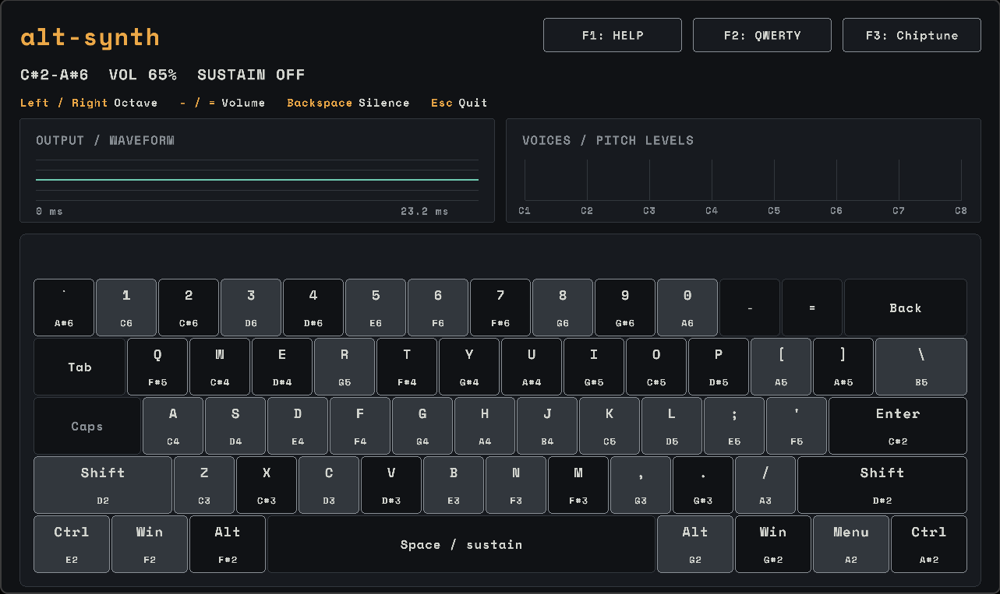

# alt-synth

A desktop synth you can play with your keyboard or mouse.

[Download for Linux x86-64](https://github.com/jake-mckenzie/alt-synth/releases)

<details>
<summary>Screenshots</summary>




</details>

## Build and run

Requires a C11 compiler, `pkg-config`, and Raylib 5.5+ development files.

```sh
./build.sh
./bin/alt-synth
```

<details>
<summary>Build Raylib locally if it is not installed</summary>

Run from the alt-synth directory on Debian or Ubuntu.

```sh
sudo apt-get install build-essential pkg-config cmake ninja-build \
    libgl1-mesa-dev libx11-dev libxcursor-dev libxi-dev libxinerama-dev libxrandr-dev
git clone --depth 1 --branch 5.5 https://github.com/raysan5/raylib.git .deps/raylib-source
cmake -S .deps/raylib-source -B .deps/raylib-build -G Ninja \
    -DCMAKE_BUILD_TYPE=Release -DBUILD_EXAMPLES=OFF -DBUILD_SHARED_LIBS=OFF \
    -DCMAKE_INSTALL_PREFIX="$PWD/.deps/raylib"
cmake --build .deps/raylib-build
cmake --install .deps/raylib-build
```

</details>

## Play

Alt-synth opens in QWERTY view with the Chiptune tone.

| Key | Action |
| --- | --- |
| F1 | Show help and key bindings |
| F2 | Switch between QWERTY and Piano |
| F3 or Tab | Cycle tones |
| Space | Hold sustain |
| Left or Right | Shift octave |
| `-` or `=` | Adjust volume |
| Backspace | Silence all notes |
| Esc | Close help or quit |

See the [playing guide](docs/playing-guide.md) for note mappings and examples.

Run `./test.sh` for the core tests. They run without Raylib or a display.

The bundled Space Mono Bold font uses the [SIL Open Font License](assets/OFL.txt).
