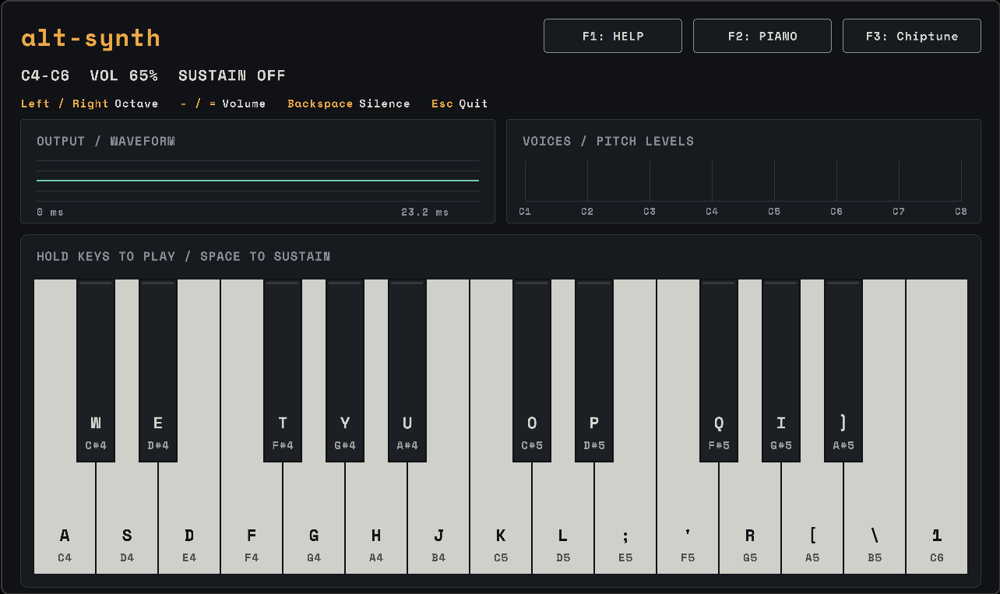

# alt-synth

A desktop synth you can play with your keyboard or mouse.

[Download for Linux x86-64](https://github.com/jake-mckenzie/alt-synth/releases)

<details>
<summary>Screenshots</summary>




</details>

## Build and run

Requires a C11 compiler and Raylib 5.5+, installed through `pkg-config` or
placed in `.deps/raylib`.

```sh
./build.sh
./bin/alt-synth
```

<details>
<summary>Use prebuilt Raylib on Linux x86-64</summary>

Download `raylib-5.5_linux_amd64.tar.gz` from the [Raylib 5.5 release](https://github.com/raysan5/raylib/releases/tag/5.5).
Install OpenGL and X11 development libraries (`libgl1-mesa-dev` and `libx11-dev`
on Debian or Ubuntu). From the alt-synth directory, extract the archive into a
fresh `.deps/raylib` directory and build.

```sh
mkdir -p .deps
mkdir .deps/raylib &&
tar -xzf ~/Downloads/raylib-5.5_linux_amd64.tar.gz -C .deps/raylib --strip-components=1
./build.sh
```

</details>

## Play

Alt-synth opens in QWERTY view with the Chiptune tone.

| Key | Action |
| --- | --- |
| F1 | Show help and key bindings |
| F2 | Switch between QWERTY and Piano |
| F3 or Tab | Cycle tones |
| Space | Hold sustain |
| Left or Right | Shift octave |
| `-` or `=` | Adjust volume |
| Backspace | Silence all notes |
| Esc | Close help or quit |

See the [playing guide](docs/playing-guide.md) for note mappings and examples.

Run `./test.sh` for the core tests. They run without Raylib or a display.

The bundled Space Mono Bold font uses the [SIL Open Font License](assets/OFL.txt).
